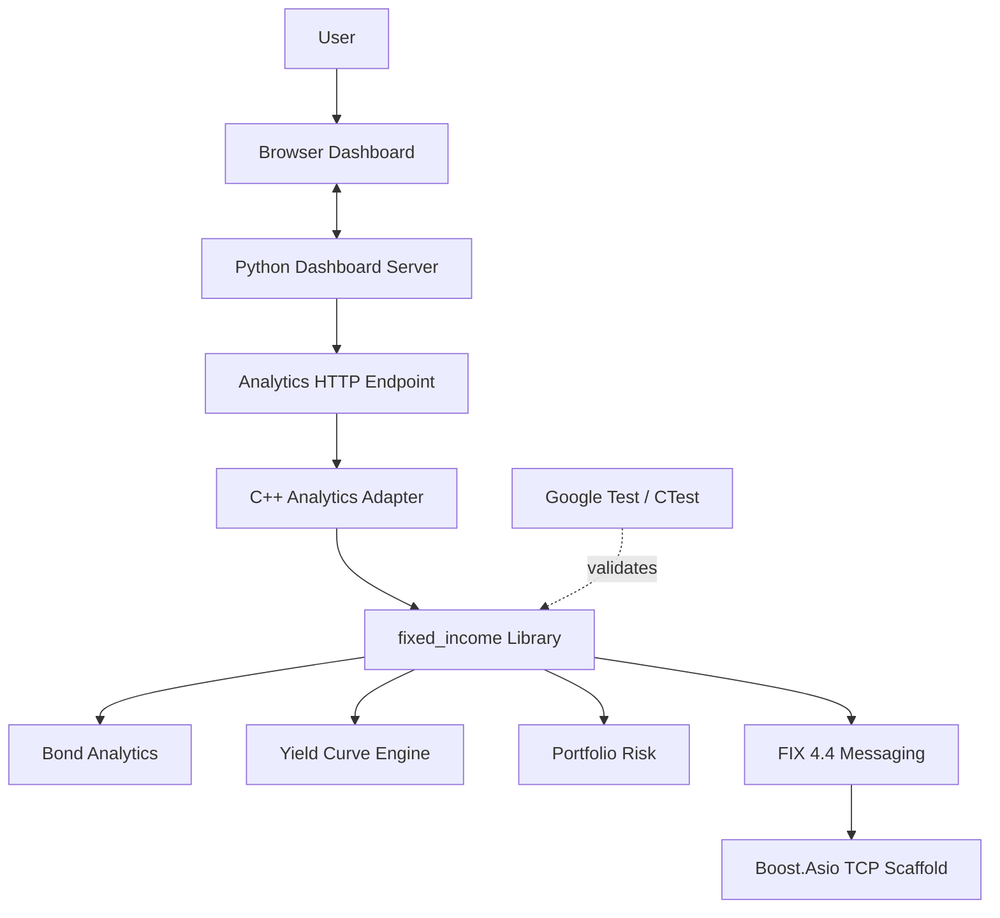
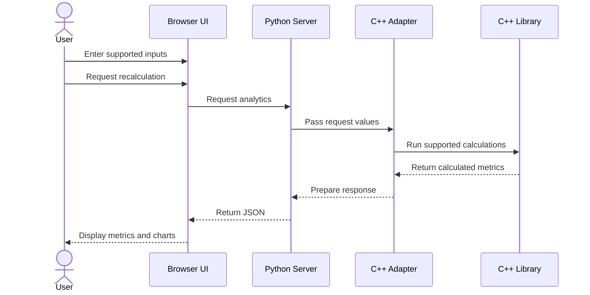
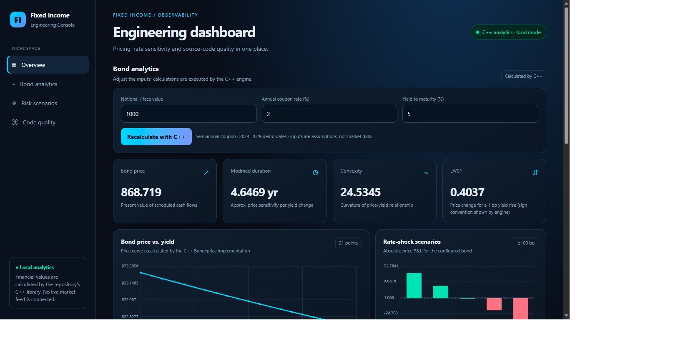

# 💹 Fixed-Income Instrument Simulator

---

# 🚀 Overview

**Fixed-Income Instrument Simulator** is a C++20 engineering project for exploring fixed-income analytics, yield-curve construction, portfolio risk, FIX 4.4 messaging, and asynchronous networking foundations. It combines a native C++ analytics library with a browser-based dashboard served by a Python HTTP layer.

> **Project scope:** Educational and portfolio project. It uses configured or illustrative inputs, not live market data by default. Validate financial conventions and protocol behavior before any production use.

## 🌟 What the project demonstrates

- 🟠 Bond cash-flow scheduling, pricing, yield-to-maturity, duration, and convexity
- 🟡 Yield-curve interpolation, discount factors, forward rates, and supported bootstrapping
- 🔴 Portfolio valuation, risk measures, and scenario-based P&L
- 🔵 FIX 4.4 message construction, parsing, and session sequence handling
- ⚙️ Boost.Asio-based asynchronous TCP transport scaffolding
- 🧪 Google Test / CTest test workflows
- 🖥️ Browser dashboard connected to the C++ analytics implementation
- 🔁 CMake-based build and GitHub Actions CI configuration

---

# 🎨 Project Color System

| Color | Engineering area | Focus |
|---|---|---|
| 🔴 **RED** | Portfolio risk | Risk measures, rate shocks, scenario P&L |
| 🟠 **ORANGE** | Bond analytics | Cash flows, valuation, YTM, duration, convexity |
| 🟡 **YELLOW** | Yield curves | Interpolation, discount factors, forward rates, bootstrapping |
| 🔵 **BLUE** | FIX & networking | FIX 4.4 messages, session sequencing, Boost.Asio transport |

These colors are README visual labels only; they do not represent an internal color-coded classification in the C++ implementation.

---

# 🧭 Table of Contents

1. [System Architecture](#-system-architecture)
2. [Analytics and Message Flows](#-analytics-and-message-flows)
3. [Core Components](#-core-components)
4. [Engineering Dashboard](#️-engineering-dashboard)
5. [Project Structure](#-project-structure)
6. [Technology Stack](#-technology-stack)
7. [Build Instructions](#️-build-instructions)
8. [Run the Simulator](#️-run-the-simulator)
9. [Dashboard API](#-dashboard-api)
10. [Testing and Code Quality](#-testing-and-code-quality)
11. [Configuration and SonarQube](#-configuration-and-sonarqube)
12. [Limitations and Future Enhancements](#-limitations-and-future-enhancements)

---

# 🏗️ System Architecture

The repository separates financial calculations, protocol handling, networking, and UI integration into distinct areas. The diagram below represents the documented high-level structure; implementation details are defined by the source files.



## 🧱 Architectural responsibilities

| Component | Responsibility |
|---|---|
| Bond analytics | Cash-flow scheduling, pricing, YTM, duration, convexity, and rate sensitivity |
| Yield-curve engine | Interpolation, discount factors, forward rates, and supported curve bootstrapping |
| Risk engine | Portfolio aggregation and scenario calculations |
| FIX messaging | Supported message fields, serialization/parsing, and session state |
| Networking | Asynchronous TCP transport scaffolding using Boost.Asio |
| Dashboard server | Serves the UI and exposes analytics data to the browser |
| Automated tests | Exercise financial, protocol, networking, and risk behavior |

---

# 🔄 Analytics and Message Flows

## 1️⃣ Dashboard calculation flow



The diagram describes the high-level integration. Refer to `dashboard/server.py` and the analytics adapter for the exact request and execution behavior.

## 2️⃣ 🟠 Bond pricing lifecycle

1. Read supported instrument terms and yield assumptions.
2. Validate the supplied values.
3. Generate scheduled cash flows.
4. Discount cash flows according to the implemented pricing convention.
5. Aggregate present values into a bond price.
6. Calculate supported yield and risk metrics.
7. Return results to the calling component.

## 3️⃣ 🟡 Yield-curve lifecycle

1. Load supported maturity and rate inputs.
2. Validate curve points and reject invalid inputs where implemented.
3. Interpolate rates using the configured supported method.
4. Calculate discount factors.
5. Derive forward rates from discount-factor relationships.
6. Bootstrap supported curve points from supported instrument inputs.

## 4️⃣ 🔵 FIX message lifecycle

1. Construct a supported FIX message.
2. Populate message fields.
3. Serialize the message for transport.
4. Pass data to the networking component.
5. Parse received message data.
6. Process supported message/session behavior.
7. Update sequence state where implemented.

## 5️⃣ 🔴 Risk scenario lifecycle

1. Calculate base instrument or portfolio value.
2. Apply a configured market scenario, such as a yield shift.
3. Recalculate the stressed value.
4. Compare stressed and base values.
5. Report the calculated change and scenario P&L.

---

# 🧩 Core Components

## 1. 🟠 Bond Analytics

The project interfaces include models such as `Bond`, `TreasuryBond`, `CorporateBond`, and `FloatingRateNote`.

**Documented capabilities include:**

- Cash-flow scheduling and bond valuation
- Yield-to-maturity solving using a Newton–Raphson approach
- Macaulay and modified duration
- Convexity and rate-sensitivity measures such as DV01/PV01
- Floating-rate note pricing with supported curve inputs

The exact supported conventions and edge cases are determined by the implementation and tests.

## 2. 🟡 Yield-Curve Engine

The yield-curve module supports documented curve calculations including:

- Linear and cubic-spline interpolation
- Discount-factor calculations
- Forward-rate calculations
- Bootstrapping from supported deposit and swap inputs

Curve results depend on supplied data and implemented conventions. They should not be treated as calibrated market curves unless market data and calibration assumptions have been independently validated.

## 3. 🔴 Portfolio Risk and Scenario Analysis

The risk module aggregates supported positions and calculates portfolio values and scenario results.

| Area | Purpose |
|---|---|
| Portfolio aggregation | Aggregate supported position values |
| Rate sensitivity | Calculate implemented sensitivity measures |
| Scenario analysis | Revalue under configured market shocks |
| Scenario P&L | Compare stressed results against the base case |

## 4. 🔵 FIX 4.4 Messaging

The FIX module provides supported message construction, serialization/parsing, and session behavior, including sequence handling for implemented message types.

Examples of documented message types include Logon, Logout, Heartbeat, TestRequest, ResendRequest, SequenceReset, SecurityDefinition, and MarketDataSnapshot.

> **Protocol note:** A message-handling scaffold is not the same as a production-certified FIX engine. Validate session recovery, persistence, sequence edge cases, conformance, and interoperability before real connectivity.

## 5. ⚙️ Boost.Asio Networking

Networking components provide an asynchronous TCP transport scaffold built around Boost.Asio. Client/server and send-queue behavior are among the areas covered by the repository's test descriptions.

Production deployments would require further work on reconnect and recovery policies, timeouts, backpressure, authentication, observability, and operational resilience.

---

# 🖥️ Engineering Dashboard

The repository includes a dark-themed browser dashboard for exploring bond analytics and viewing code-quality measures when a SonarQube server is configured and real analysis data is available.



*Screenshot path: `docs/images/FixedIncomeCal_1.jpg`. GitHub will display the image only if that file is present at this path in the repository.*

## Dashboard areas

| Area | Purpose |
|---|---|
| Overview | Dashboard status and navigation |
| Bond analytics | Configure supported notional, coupon, and yield inputs |
| Price-yield chart | Explore calculated bond-price behavior across yield values |
| Risk scenarios | Compare configured interest-rate shocks and scenario P&L |
| Code quality | Show real analysis measures when configured and available |

## 📊 Illustrative analytics

For an illustrative face value of `1,000`, coupon rate of `5%`, and yield to maturity of `5%`, a previously reported example included the following values:

| Metric | Example value |
|---|---:|
| Bond price | 1,000.00 |
| Macaulay duration | 4.4854 years |
| Modified duration | 4.3760 years |
| Convexity | 22.6123 |
| DV01 | 0.4376 per basis point |

These values are illustrative, not live market quotes or a guarantee that every build/configuration will produce identical results. Confirm them against the current executable and pricing assumptions.

---

# 📂 Project Structure

```text
Fixed-Income-Instrument-Simulator/
├── .github/
│   └── workflows/
│       └── ci.yml
├── dashboard/
│   ├── server.py
│   └── README.md
├── docs/
│   └── images/
│       └── FixedIncomeCal_1.jpg
├── include/
│   └── fixed_income/
│       ├── bond.hpp
│       ├── yield_curve.hpp
│       ├── risk.hpp
│       ├── fix.hpp
│       └── network.hpp
├── src/
│   ├── bond.cpp
│   ├── yield_curve.cpp
│   ├── risk.cpp
│   ├── fix.cpp
│   ├── network.cpp
│   ├── dashboard_data.cpp
│   └── main.cpp
├── tests/
├── CMakeLists.txt
├── CMakePresets.json
├── sonar-project.properties
└── README.md
```

This is a high-level view of the repository structure; inspect the working tree for the complete list of files and tests.

---

# 🧰 Technology Stack

| Technology | Role |
|---|---|
| **C++20** | Financial models and systems components |
| **CMake** | Configure and build the project |
| **Boost.Asio / Boost.System** | Asynchronous TCP networking scaffold |
| **Google Test / CTest** | Unit testing and test execution |
| **Python 3** | Dashboard HTTP server/integration layer |
| **GitHub Actions** | Configured continuous-integration workflow |
| **clang-tidy** | Static analysis where configured |
| **SonarQube** | Optional code-quality integration when compatible analysis is configured |

---

# ⚙️ Build Instructions

## 📋 Prerequisites

- C++20-compatible compiler
- CMake version required by the repository configuration (the documented setup uses CMake 3.24 or later)
- Boost version/components requested by `CMakeLists.txt`
- Python 3 for the dashboard
- Git

Check the installed tools:

```bash
g++ --version
cmake --version
python3 --version
```

## 1️⃣ Clone the repository

```bash
git clone https://github.com/RoyalTejShinde1993/Fixed-Income-Instrument-Simulator.git
cd Fixed-Income-Instrument-Simulator
```

## 2️⃣ Configure the build

```bash
cmake -S . -B build
```

## 3️⃣ Compile

```bash
cmake --build build -j2
```

## 4️⃣ Run the demo

```bash
./build/fixed_income_demo
```

Example output previously reported by the project:

```text
Bond price: 1000
Yield to maturity: 0.05
Duration: 4.37603
Demo initialized. Run a local FIX server on port 15001 to connect.
```

Your output can vary with the current implementation. The message about port `15001` does not mean a FIX server is automatically running; start a compatible local server if you want to test a connection.

---

# ▶️ Run the Engineering Dashboard

## 🖥️ Local run

After building the project, start the dashboard server:

```bash
python3 dashboard/server.py
```

Open the configured local address in your browser. The default host and port are defined by the dashboard server/configuration; consult `dashboard/README.md` if the default differs from your environment.

## ☁️ GitHub Codespaces example

If the server supports the documented host/port environment variables, launch it with:

```bash
FI_DASHBOARD_HOST=0.0.0.0 \
FI_DASHBOARD_PORT=8081 \
python3 dashboard/server.py
```

Keep the terminal running. Open the Codespaces **Ports** panel, locate port `8081`, and open its forwarded URL. Only expose the dashboard as broadly as needed for your development environment.

---

# 🔌 Dashboard API

The documented analytics endpoint is:

```http
GET /api/analytics
```

For the Codespaces example above, inspect it with:

```bash
curl -sS http://localhost:8081/api/analytics
```

Example response shape (abbreviated):

```json
{
  "source": "C++ fixed_income library",
  "inputs": {
    "notional": 1000,
    "couponRate": 0.05,
    "yieldToMaturity": 0.05
  },
  "analytics": {
    "price": 1000,
    "modifiedDuration": 4.376,
    "convexity": 22.612
  },
  "priceYield": [],
  "stress": []
}
```

This JSON is an illustrative response shape, not a complete captured response. The live endpoint returns the fields and values produced by the current implementation.

---

# 🧪 Testing and Code Quality

## Run the tests

```bash
ctest --test-dir build --output-on-failure
```

The README's previous test record reported 24 passing tests. Run the command above on the current checkout to verify the present result.

### Areas described as covered

- Bond cash-flow schedules, pricing, YTM, duration, convexity, floating-rate pricing, and validation
- Yield-curve interpolation, discount factors, forward rates, and bootstrapping
- FIX message creation/parsing and session sequence behavior
- Networking connection and send-queue behavior
- Risk measures, portfolio market value, and scenario P&L

## Optional sanitizer build

If the current CMake configuration supports `ENABLE_SANITIZERS`, build and test with:

```bash
cmake -S . -B build-sanitizers -DENABLE_SANITIZERS=ON
cmake --build build-sanitizers -j2
ctest --test-dir build-sanitizers --output-on-failure
```

If the repository defines matching presets, you can also use:

```bash
cmake --preset default
cmake --preset sanitizers
```

## Developer verification loop

```bash
git diff --check
cmake -S . -B build
cmake --build build -j2
ctest --test-dir build --output-on-failure
```

For a change affecting dashboard metrics, start the server and verify `/api/analytics` as well. Add regression tests for behavior changes and review the diff before committing.

---

# 🔐 SonarQube Integration

The dashboard can show SonarQube measures when the server URL, project key, token, and analysis results are correctly configured. Metrics should remain unavailable when there is no real analysis data; do not substitute synthetic values.

Set the environment variables on the dashboard server:

```bash
export SONAR_HOST_URL="https://your-sonarqube.example"
export SONAR_PROJECT_KEY="your-project-key"
export SONAR_TOKEN="your-token"
python3 dashboard/server.py
```

Never commit tokens or credentials. Use repository variables for non-secret CI configuration and repository secrets for tokens.

**C++ analysis note:** SonarQube C++ analysis requires a compatible analyzer and valid build/compilation information. Check the licensing and analyzer availability of your SonarQube edition. `clang-tidy` and Cppcheck are alternatives for C++ diagnostics.

---

# 🚀 Future Enhancements

Potential directions for future development include:

- Expand day-count conventions, holiday calendars, and settlement handling.
- Improve yield-curve calibration and validation coverage.
- Add portfolio-level DV01 and key-rate duration analytics.
- Extend floating-rate reset and projection mechanics.
- Improve FIX session recovery, persistence, and protocol conformance testing.
- Add network backpressure, timeout, and reconnect tests.
- Add repeatable pricing and message-processing benchmarks.
- Integrate verified static-analysis and coverage results into the dashboard.
- Expand CI, sanitizer, and regression-test coverage.

These are possible enhancements, not claims that the features are already implemented.

---

# 👨‍💻 Author

**Tejas Tanaji Shinde** · Pune, India

- GitHub profile: [@RoyalTejShinde1993](https://github.com/RoyalTejShinde1993)
- Project repository: [Fixed-Income-Instrument-Simulator](https://github.com/RoyalTejShinde1993/Fixed-Income-Instrument-Simulator)

---

# ⭐ Support the Project

If this project helps you explore modern C++, financial mathematics, risk analytics, protocol fundamentals, or systems engineering, consider starring the repository and sharing feedback.

---

<div align="center">

**💹 Modern C++20 · Fixed-Income Analytics · Portfolio Risk · FIX 4.4 · Systems Engineering**

*Educational engineering project — validate all calculations and protocols before production use.*

</div>
